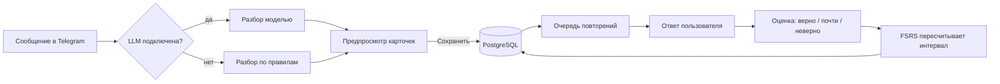

<h1 align="center">eng-remember</h1>

<p align="center">
  <strong>Telegram-бот для запоминания иностранных слов: добавляйте свои слова, повторяйте их по FSRS и проверяйте ответ вводом, а не угадыванием.</strong>
</p>

<p align="center">
  <a href="https://github.com/necroz/eng-remember/actions/workflows/ci.yml"></a>
  
  <a href="LICENSE"></a>
  <a href="https://t.me/EngRememberBot"></a>
</p>

<p align="center">
  <a href="https://t.me/EngRememberBot"><strong>👉 Открыть @EngRememberBot</strong></a>
</p>

---

**eng-remember** — бот для тех, кто учит иностранные слова и устал вручную собирать колоды. Пришлите слово, фразу или абзац текста — бот разберёт его, предложит карточки и сохранит только то, что вы подтвердите. Дальше он сам решает, когда показать слово снова: по алгоритму FSRS, который учитывает, насколько хорошо вы помните каждую карточку.

Поддерживаются 17 изучаемых языков, а перевод всегда русский. Язык хранится на каждой карточке, поэтому в одной колоде могут соседствовать английские, французские и китайские слова.

## Зачем это нужно

Обычные карточки требуют дисциплины: создать колоду, заполнить поля, не забыть повторить. В Telegram это ближе: отдельное приложение не нужно, а слова можно брать прямо из того, что вы читаете.

Бот закрывает три вещи:

- **Добавление без рутины.** Свободный текст, тема или абзац — бот разбирает запрос, показывает карточки и ждёт подтверждения.
- **Повторение, которое подстраивается.** Вы вводите ответ, бот сам ставит оценку и пересчитывает интервал по FSRS.
- **Привычка.** Серии, заморозки, напоминания и недельный дайджест помогают возвращаться каждый день.

Для кого: взрослые, которые учат иностранный язык самостоятельно и хотят тратить на повторение 5–10 минут в день.

Чем отличается от обычных карточек:

- можно добавлять слова из свободного текста, темы или абзаца;
- две стороны слова — узнавание и вспоминание — учатся отдельно;
- ответ вводится руками, а не выбирается из четырёх вариантов;
- бот работает и без LLM: пары «слово — перевод» разбираются правилами;
- расписание считает FSRS, а не фиксированные «через 1, 3, 7 дней».

## Что умеет

### Добавление слов

- **Свободный текст.** `ubiquitous — вездесущий`, `bonjour — здравствуйте`, `书 — книга`, `добавь слова resilient и thorough` — бот разберёт сообщение и покажет карточки на подтверждение.
- **Подбор по теме.** `ещё 10 слов про медицину` — модель подберёт лексику на нужном языке. Кнопка «🔄 Ещё слова» даёт другую подборку, не сохраняя текущую.
- **Слова из текста.** Пришлите абзац — бот найдёт слова в нём и проверит, что каждое действительно есть в тексте.
- **Слово с контекстом.** `arrangement как во фразе ... и ещё пару слов на эту тему` — перевод по смыслу из фразы плюс подобранные слова того же домена. «🔄 Ещё слова» меняет только найденную половину — ваше слово остаётся в пакете.
- **Уточняющие вопросы.** Если запрос расплывчатый, бот задаст один вопрос с вариантами — или предложит решить самому. Больше двух уточнений подряд не задаёт.
- **CEFR-уровень.** Модель оценивает уровень и редкость слова; бейдж виден до сохранения. `/level B1` задаёт ваш уровень, под который мягко подстраивается подбор.

### Языки

- **Список:** английский, китайский (мандарин), хинди, испанский, арабский (стандартный), французский, бенгальский, португальский, индонезийский, немецкий, японский, вьетнамский, суахили, турецкий, корейский, тайский, итальянский. Коды: `eng`, `cmn`, `hin`, `spa`, `arb`, `fra`, `ben`, `por`, `ind`, `deu`, `jpn`, `vie`, `swh`, `tur`, `kor`, `tha`, `ita`.
- **Перевод — только русский.** Русский не является изучаемым языком и не создаётся как карточка.
- **Язык — свойство карточки.** Одна коллекция может смешивать языки; у каждой карточки свой язык и своё расписание.
- **Автоопределение.** С моделью язык определяется по слову и сообщению. Без модели — по письменности: иероглифы → китайский, кана → японский, хангыль → корейский, арабская вязь → арабский, деванагари → хинди, бенгальская письменность → бенгальский, тайская → тайский. Латиница без указания языка считается английской; кириллица как изучаемый язык не принимается.
- **Если язык угадан неверно.** Укажите его в сообщении: `французское слово hotel — отель`. Язык уже сохранённой карточки не редактируется. Китайский — только мандарин, арабский — только стандартный, без диалектов.

### Повторение

- **`/review`.** Бот показывает иностранное слово, вы вводите перевод — или жмёте «🤷 Не знаю». Правильное значение показывается после ответа, поэтому вспоминать приходится самому.
- **Оценка по правилам.** Верно и быстрее 5 секунд — «Легко», верно, но дольше — «Нормально», почти — «Трудно», неверно или «Не знаю» — «Не помню». Подсказка ограничивает оценку «Нормально».
- **Проверка ответа.** Сначала точное совпадение; если не совпало и подключена модель — семантическая проверка. Без модели несовпадение считается ошибкой.
- **Две стороны.** Каждое слово — две карточки: иностранное слово → перевод и перевод → слово на изучаемом языке. У каждой своё расписание FSRS. Новые слова вводятся сначала прямой стороной, обратная приходит на следующий день. На обратной карточке бот показывает перевод и ждёт слово на изучаемом языке; синоним засчитывается как «Трудно».
- **Новое — со следующего дня.** Слово не выпадает на повторение в день добавления: сначала оно должно отлежаться.
- **Лимит по карточкам.** 20 новых в день — это 20 карточек, а не 20 слов: обратные стороны прежних дней тоже занимают бюджет.
- **Подсказка и лечение.** «💡 Подсказка» показывает пример с пропущенным словом; примеры не повторяются. После четырёх провалов — меню: мнемоника, свежий пример, пауза (`/paused`), оставить.
- **Похвала без повторов.** После ответа — короткая реплика из банка на ~140 шаблонов; шаблоны идут «мешком» и не повторяются, пока не кончится банк.

### Тренировка

- **`/practice`.** Квиз с четырьмя вариантами по уже знакомым словам. Интервалы, серия и статистика не меняются; на экране «повторять нечего» бот сам предлагает потренироваться.

### Прогресс и привычка

- **Серии и заморозки.** День засчитывается с первого ответа, серия растёт. За каждые 7 дней подряд — заморозка (до трёх); пропущенный день она закрывает сама. Без заморозки серия прерывается.
- **Статистика.** `/stats` — очередь, серия, ответы и хитмап за 4 недели.
- **Напоминания.** Утро 08:00 и вечер 18:00 по умолчанию, в вашем часовом поясе. Утром — если есть что повторять; вечером — остаток очереди и предупреждение, если серия под угрозой. По понедельникам утреннее сообщение заменяет недельный дайджест.
- **Настройки.** `/remind`, `/tz`, `/limit`.

### Данные и настройки

- **Экспорт.** `/export` — CSV со словами, колодами, тегами и кодом языка.
- **Импорт.** `/import` или присланный CSV: предпросмотр, дубли пропускаются, незнакомые колоды создаются, строки без перевода пропускаются. Необязательная колонка `language` задаёт язык; без неё язык определяется по письменности. С подключённой моделью переводы дозаполняются по группам языков.
- **Колоды и пауза.** `/decks`, `/paused`.
- **Работа без LLM.** Без ключа бот понимает пары «слово — перевод», а проверка ответа идёт по точному совпадению. Язык определяется по письменности, латиница считается английской. Подбор слов, семантическая проверка, примеры и CEFR требуют модели.

## Как это работает



Короткий цикл:

1. **Добавили.** Бот разобрал слово, тему или текст и показал карточки.
2. **Подтвердили.** В базу попадает только то, что вы сохранили.
3. **Повторили.** На следующий день бот показывает слово, вы вводите ответ.
4. **Получили интервал.** FSRS обновляет состояние памяти и решает, когда спросить снова.

### Почему FSRS

FSRS — современный алгоритм интервального повторения, тот же класс, что в новом Anki. Для каждой карточки он хранит сложность и стабильность памяти и подбирает следующий интервал так, чтобы вероятность вспоминания к моменту показа была около 90%.

- Легко вспомнили — интервал растёт.
- Ошиблись — карточка возвращается раньше.
- Две стороны карточки — два независимых расписания: узнать слово и вспомнить его из перевода — разные навыки.
- Новые карточки стартуют со следующего дня, чтобы не зазубривать слово в той же сессии, где вы его добавили.

Правила FSRS, серий и оценки ответа живут в чистом доменном слое и проверяются тестами без базы и Telegram.

### LLM не обязательна

Бот полностью работоспособен без ключа модели: пары «слово — перевод» разбираются правилами, ответ проверяется точным совпадением. С любым OpenAI-совместимым эндпоинтом (OpenAI, OpenRouter, DeepSeek, vLLM, Ollama) включаются подбор слов, семантическая проверка, примеры и CEFR. Расход ограничен на пользователя: 60 интерактивных вызовов, ещё 30 на генерацию примеров и 100 000 токенов в сутки. Общий бюджет бота — 2 000 000 токенов в сутки: на 80% приходит алерт (если задан `BOT__ADMIN_CHAT_ID`), на 100% модель отключается и бот работает по правилам. Один пользователь не запускает два модельных запроса параллельно; одинаковый текст в течение минуты не обрабатывается дважды; входящий поток ограничен 10 сообщениями и 30 нажатиями в минуту.

## Попробовать

1. Откройте [@EngRememberBot](https://t.me/EngRememberBot) и нажмите Start.
2. Пришлите 5–10 слов или абзац текста, который читаете.
3. Подтвердите карточки.
4. На следующий день нажмите `/review` — бот покажет первое слово.

Дальше напоминания придут сами. Если что-то не нравится, начните с `/stats`, `/level` и `/remind`.

## Запустить у себя

Нужны Python 3.12+, [uv](https://docs.astral.sh/uv/) и Docker.

```bash
cp .env.example .env          # вписать BOT_TOKEN от @BotFather
make install
make db-up                    # Postgres в Docker на порту 55432
make migrate                  # применить миграции
make run                      # запустить бота
```

Ключ LLM не обязателен. Чтобы подключить модель, заполните `LLM__API_KEY` и при необходимости `LLM__BASE_URL` — подойдёт любой OpenAI-совместимый эндпоинт. Лимиты расхода: `LLM__MAX_CALLS_PER_DAY`, `LLM__MAX_EXAMPLE_CALLS_PER_DAY`, `LLM__MAX_TOKENS_PER_DAY` и `LLM__MAX_TOKENS_PER_DAY_GLOBAL` (0 — без ограничения). Алерты о глобальном бюджете приходят в `BOT__ADMIN_CHAT_ID`, если он задан.

Напоминания рассылает сам бот — отдельный планировщик не нужен. Если бот масштабируется на несколько реплик, включите `REMINDERS__ENABLED=false` и запускайте `eng-remember-remind` из cron: иначе каждая реплика отправит своё.

### Docker

```bash
cp .env.example .env
docker compose --profile full up -d --build
docker compose logs -f bot
```

Схему создаёт одноразовый сервис `migrate` до старта бота, поэтому на пустом сервере всё поднимается одной командой. Обновление — `git pull` и повторный `up -d --build`.

Креды к LLM, бэкап, диагностика и несколько реплик — в [docs/deploy.md](docs/deploy.md).

## Разработка

Стек: Python 3.12, aiogram 3, PostgreSQL, SQLAlchemy 2 async, Alembic, py-fsrs, OpenAI-совместимый клиент.

```
src/eng_remember/
├── domain/        правила: FSRS, серии, оценка ответа — без БД и Telegram
├── db/            движок, сессия, UtcDateTime
├── models/        таблицы SQLAlchemy
├── repositories/  все SQL-запросы
├── services/      сценарии: карточки, повторение, серии, подбор слов, LLM
└── bot/           роутеры, middleware, клавиатуры, тексты
```

Зависимости направлены в одну сторону: `bot → services → repositories → db`, а `services → domain` без обратной связи.

```bash
make help              # список целей
make check             # lint + типы + юнит-тесты
make test              # 739 юнит-тестов, без инфраструктуры
make test-integration  # 16 тестов против Postgres
make test-all          # всё вместе
make audit             # pip-audit по зафиксированным зависимостям
make migrate           # применить миграции
make revision m="..."  # создать миграцию
make db-up / db-down / db-reset
make docker-up / docker-down / docker-logs
```

Тесты гоняют бота через настоящий диспетчер с подменённой только отправкой в Telegram, поэтому проверяют маршрутизацию, фильтры и разбор callback-данных, а не их имитацию. Регрессии на экранирование и prompt injection — в `tests/test_security.py`.

## Документация

- [Дизайн, модель данных и компромиссы](docs/superpowers/specs/2026-10-12-eng-remember-design.md)
- [Деплой: Docker, LLM, бэкап, диагностика](docs/deploy.md)
- [Безопасность: лимиты, логи, инциденты](docs/security.md)

## Обратная связь

Нашли баг или есть идея — создайте [issue](https://github.com/necroz/eng-remember/issues).

## Лицензия

Код распространяется по [MIT](LICENSE). © 2026 Igor Lashkevich.
